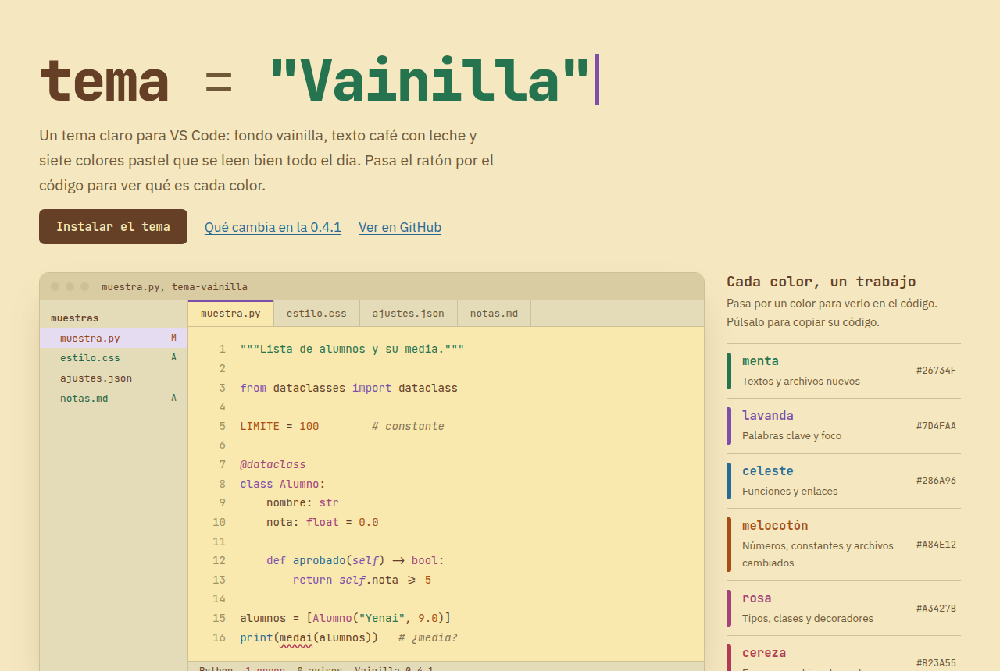

# Vainilla

Un tema claro para Visual Studio Code: fondo vainilla, texto café con leche y siete colores pastel
que se leen bien todo el día.



**[Prueba la demo interactiva](https://sryena.github.io/tema-vainilla/)**: pasa el ratón por el código
para ver qué significa cada color.

## Instalación rápida

1. Descarga **[vainilla-0.4.1.vsix](https://github.com/sryena/tema-vainilla/raw/main/releases/vainilla-0.4.1.vsix)**.
2. Instálalo desde una terminal:

   ```bash
   code --install-extension vainilla-0.4.1.vsix
   ```

3. En VS Code pulsa `Ctrl+K` y luego `Ctrl+T`, y elige **Vainilla**.

¿Sin terminal, en Windows, o algo no funciona? La **[guía de instalación](INSTALACION.md)** lo explica
paso a paso, con cómo actualizar y desinstalar.

## Por qué Vainilla

- **Claro sin deslumbrar.** El fondo no es blanco, es vainilla (`#F9E9AF`), y las zonas de alrededor
  (barra lateral, pestañas, terminal) van en un vainilla grisáceo un poco más oscuro.
- **Cada color significa siempre lo mismo**, en el código y en la interfaz: si algo es menta, es un
  texto o un archivo nuevo, estés en Python, en CSS o en el explorador de archivos.
- **Contraste comprobado.** Todos los colores del código llegan a 4,5:1 sobre el fondo, el mínimo para
  leer cómodo (WCAG AA). Desde la 0.4.1 también los de la barra lateral.

## Colores

| Color | Código | Qué pinta |
|---|---|---|
| Vainilla | `#F9E9AF` | Fondo del editor |
| Café con leche | `#654027` | Texto normal |
| Menta | `#26734F` | Textos (strings) y archivos nuevos en Git |
| Lavanda | `#7D4FAA` | Palabras clave (`if`, `def`, `class`), foco y archivos sin seguimiento |
| Celeste | `#286A96` | Funciones y enlaces |
| Melocotón | `#A84E12` | Números, constantes y archivos modificados |
| Rosa | `#A3427B` | Tipos, clases y decoradores |
| Cereza | `#B23A55` | Errores y archivos borrados |
| Mostaza | `#7C5E0C` | Avisos |
| Comentario | `#857455` | Comentarios, en cursiva |

La guía visual completa, con qué color lleva cada parte de la ventana, está en
[`paleta.html`](paleta.html) (ábrela en el navegador).

## Qué hay en el repositorio

| Ruta | Qué es |
|---|---|
| `themes/vainilla-color-theme.json` | El tema: colores de la interfaz y del código |
| `package.json` | La ficha de la extensión para VS Code |
| `releases/` | Los `.vsix` listos para instalar |
| `paleta.html` | Guía visual de los colores |
| `muestras/` | Archivos de ejemplo (HTML, CSS, Python, Markdown, JSON) para ver el tema |
| `docs/` | La demo interactiva que se publica en GitHub Pages |

## Versiones

- **0.4.1** (2026-10-20): los colores de Git, errores, avisos y coincidencias de búsqueda de la barra
  lateral, un tono más oscuros para llegar a 4,5:1 sobre el gris y la selección (antes, 3,9-4,2:1). Los
  colores del código no cambian.
- **0.4.0** (2026-10-08): fondo y grises un 20 % más claros.
- **0.3.0** (2026-10-08): fondo `#F7E49B` y grises derivados de él.
- **0.2.0** (2026-10-08): fondo más amarillo, grises de vainilla, café con leche y melocotón anaranjado.
- **0.1.0** (2026-10-08): primera versión, con la paleta y las muestras.

## Licencia

[MIT](LICENSE): puedes usar, copiar, modificar y compartir el tema, también en proyectos comerciales,
siempre que mantengas el aviso de copyright.

## Autor

Hecho por **Yenai Lorente Casado**, estudiante de ASIX. Más sobre mí en
[mi currículum](https://sryena.github.io/Curriculum/).
